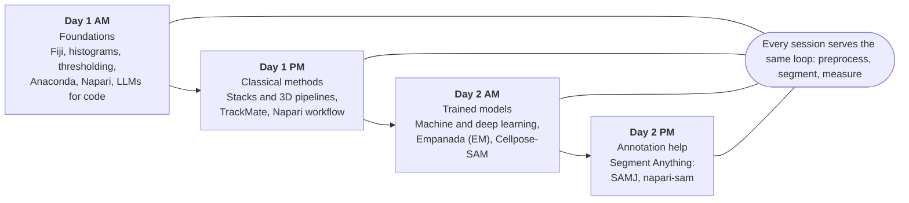

# 3D Volume Image Analysis for Biologists (2026)

**Keywords:** 3D image analysis · Fiji · Napari · image segmentation · deep learning · Cellpose · Empanada · Segment Anything · TrackMate · volume EM

Slides from the two-day course on 3D volume image analysis, from Fiji and Napari basics to AI-assisted segmentation. This page summarizes the four PDFs and doubles as a study cheat sheet.

| Session | PDF | Topic |
| --- | --- | --- |
| Day 1 AM | [3D_Volume_Day1AM_Final.pdf](3D_Volume_Day1AM_Final.pdf) | Image formation, Fiji, Anaconda, Napari, LLMs |
| Day 1 PM | [3D_Volume_Day1PM_Final.pdf](3D_Volume_Day1PM_Final.pdf) | Stacks, 3D pipelines, tracking, Napari workflow |
| Day 2 AM | [3D_Volume_Day2AM_Final.pdf](3D_Volume_Day2AM_Final.pdf) | Machine learning, Empanada, Cellpose |
| Day 2 PM | [3D_Volume_Day2PM_Final.pdf](3D_Volume_Day2PM_Final.pdf) | Segment Anything: SAMJ, napari-sam |

## Course at a glance

The course moves from classical thresholding to trained models and AI-assisted annotation, on the same preprocess, segment, measure loop.



## Day 1 AM: Fiji, Anaconda, Napari, LLMs

An image is a grid of numbers, so check its histogram for saturation or clipping before you threshold anything.

| Task | Fiji menu path |
| --- | --- |
| Intensity profile | Analyze > Plot Profile (Ctrl+K) |
| Brightness / contrast | Image > Adjust > Brightness/Contrast ("Apply" changes pixel values, so Duplicate first) |
| Split channels | Image > Color > Split Channels |
| Smooth before thresholding | Process > Filters > Gaussian Blur (sigma 2 in the exercise) |
| Threshold | Image > Adjust > Threshold |
| Count and measure objects | Analyze > Set Measurements, then Analyze > Analyze Particles |
| Lookup table | Image > Color > Edit LUT / Show LUT |

**Reading a histogram**

- Saturated: many pixels pile up at the maximum value.
- Clipped (underexposed): low values are cut off at the minimum.
- Good use of dynamic range: values spread across the available range without piling at either end.

**Standard workflow:** preprocess (denoise, remove background, deconvolve), then segment (threshold, machine or deep learning), then measure (shape, intensity, distance).

**Anaconda in three lines**

```
conda create --name env-napari python=3.12
conda activate env-napari
pip install --requirement requirements.txt
```

- pip installs Python packages from PyPI; conda-forge also covers other languages but its solver is slow (mamba and uv are faster).
- Never install into the base environment.

**Napari basics:** an n-dimensional viewer in Python built on layers (image, labels, points), with a scale bar and plot profile.

**LLMs for bioimage analysis** (slides by Robert Haase)

- LLMs generate analysis code; vision models describe and count objects.
- Vision-model counts change with model version and prompt wording, so keep control of the model to stay reproducible.
- Peer-review all AI-generated analysis.

## Day 1 PM: stacks, 3D pipelines, tracking

A pixel's address is the set of coordinates you need to find it; a stack adds z or time, and a hyperstack combines up to five dimensions (x, y, z, channel, time).

**Fiji stack tools**

| Goal | Menu path |
| --- | --- |
| Collapse z or time into 2D | Image > Stacks > Z Project (Max, Sum, SD, Average, Median, Min) |
| Intensity over time | Image > Stacks > Plot Z-axis Profile |
| Fix photobleaching | Image > Adjust > Bleach Correction ("simple ratio" with the background value) |
| Inspect in 3D | Image > Stacks > Orthogonal Views; Plugins > Volume Viewer |
| Split interleaved channels | Image > Stacks > Tools > Deinterleave, or Slice Keeper |
| Remove or keep slices | Image > Stacks > Tools > Slice Remover / Slice Keeper |
| Tile or merge stacks | Make Montage, Combine, Reverse, Concatenate |

**Whole 3D analysis pipeline (GFP neurons exercise)**

1. FeatureJ Laplacian with smoothing scale 2.
2. Threshold the filtered image (untick "dark background"), convert to mask.
3. Process > Binary > Fill Holes.
4. Analyze > 3D OC Options: pick measurements and redirect to the original stack.
5. Analyze > 3D Objects Counter (threshold 128, minimum size 5 voxels).

**Tracking with TrackMate**

- Good tracking needs good signal-to-noise, little bleaching, and an acquisition rate matched to the motion.
- Detectors: LoG (general blobs), DoG (fastest for small spots of about 5 pixels), Hessian (better against strong edges), or ML/DL segmentation.
- Trackers: Nearest-neighbour (simplest), Simple LAP and LAP (Brownian-like motion, not too dense), Kalman (near-constant velocity), Overlap (complex shapes, small movements).
- Typical outputs: speed, distance travelled, persistence, split and merge events.
- Newer options mentioned: Trackastra (transformer-based linking) and Ultrack (tracking under segmentation uncertainty).

**Napari workflow (3D nuclei sample)**

1. Median filter 3x3x3 (n-SimpleITK) to denoise; a median filter preserves edges better than a Gaussian.
2. Binarize with the Kittler & Illingworth threshold.
3. Binary Fill Holes.
4. Label nuclei with Touching object labeling (watershed on a distance map), so each nucleus gets its own index.
5. Measurements (size, intensity, shape), then Plot Measurements to classify nuclei by hand.
6. Record the script editor to save the workflow as Python.

## Day 2 AM: machine learning and deep learning segmentation

Use classical methods when objects separate cleanly by intensity; use trained models when thresholds fail, and retrain on your own data when pretrained models miss.

**Image problem types:** classification (one class per image), semantic segmentation (one class per pixel), instance segmentation (separate objects), object detection (boxes plus classes), counting, restoration.

**Model families on the slides**

- Random forest pixel classifiers: learn rules from hand-crafted features and a few annotations (Fiji, Napari with APOC, ilastik).
- U-Net: encoder-decoder CNN for pixel segmentation.
- StarDist: nuclei segmentation (Fiji plugin is 2D prediction only; Python and Napari support 2D and 3D).
- CARE: content-aware image restoration.

**Empanada (3D mitochondria in EM)**

1. Test first: Plugins > Empanada > 3D Inference with MitoNet_v1_mini on the sample EM volume.
2. Retrain: merge images to a stack, place 1-2 points per slice (at least 16), pick training patches, paint each mitochondrion with its own label, save patches.
3. Finetune (less memory, faster, data close to the original) or train a new model (heavy, needs more annotated data, more accurate).
4. Tips: annotate all objects in the field of view, and include patches without objects.

**Cellpose**

- Predicts a pixel mask plus flow vectors pointing to cell centres; pixels whose flows end at the same centre form one cell.
- Test in Fiji: Plugins > Segmentation > Cellpose-SAM, model cpsam_v2, Mode 3D set to None for 2D.
- 3D modes: "2D + stitch" is fast (2D segmentation plus connected components); "3D mode" intersects XY with XZ/YZ segmentations and is slow.
- Finetune in the GUI (run `cellpose` inside env-napari): curate masks, Models > Train new model (Ctrl+T), then pick the result under custom models.

| | Cellpose 3 | Cellpose-SAM |
| --- | --- | --- |
| Speed | Faster | About 20x slower |
| Object size | Size dependent | Size independent |
| 3D | Weak | Very good |
| Maturity | Stable | In development |

## Day 2 PM: Segment Anything as an annotation assistant

Segment Anything (SAM) speeds up drawing ground truth: you click or box an object and the model proposes the mask, which you then correct.

| Tool | Where | Notes from the slides |
| --- | --- | --- |
| SAMJ | Fiji | Uses SAM v2 but limited to v1-style use. Choose EfficientViTSAM-I2, click the arrow to install (a few minutes), click Go, toggle Live. |
| [napari-sam](https://github.com/MIC-DKFZ/napari-sam) | Napari | SAM v1. Own environment with Python 3.9; model vit-b; one label layer, one click per object. |
| [napari-SAMV2](https://github.com/Krishvraman/napari-SAMV2) | Napari | SAM v2, needs git. |
| [napari-sam3-assistant](https://github.com/wulinteousa2-hash/napari-sam3-assistant) | Napari | SAM v3, GPU only. |

**napari-sam controls:** press = to increase the label id in click mode, wheel-click to include a region, Ctrl + wheel-click to exclude it, and switch to Bounding Boxes when clicks are not enough.

## Quick reference

Start with the simplest method that works, and move down this table only when the one above fails.

| Situation | Tool or method |
| --- | --- |
| Bright objects on a clean background | Gaussian blur, threshold, Analyze Particles (Fiji) |
| Touching nuclei in 3D | Median filter, threshold, watershed labels (Napari) |
| Moving spots or cells over time | TrackMate (Fiji), Trackastra or Ultrack |
| Cells or nuclei of varied appearance | Cellpose-SAM (Fiji or GUI); StarDist for round nuclei |
| Organelles in volume EM | Empanada (MitoNet), finetuned on your patches |
| Fast ground-truth annotation | SAMJ (Fiji) or napari-sam |
| Noisy images | Denoise first (median, Gaussian, CARE) |

**Classical image analysis vs deep learning**

| | Classical | Deep learning |
| --- | --- | --- |
| Hand annotation | Not needed | Needed for supervised training |
| Special hardware | No | Yes for training (GPU) |
| Speed | Fast | Slow to moderate at prediction |
| Interpretability | Easy | Hard |
| Accuracy | Moderate to good | Best when trained on your sample |
| Re-usability | Moderate | Low to high (retraining helps) |

Classical analysis is not obsolete: it is fast, needs no annotation and is easy to interpret.

## Self-test

Cover the answers and try each question.

| # | Question | Answer |
| --- | --- | --- |
| 1 | What is the difference between a clipped and a saturated image? | Clipped: low values cut off at the minimum. Saturated: high values piled up at the maximum. |
| 2 | Why duplicate an image before pressing Apply in Brightness/Contrast? | Apply changes the pixel values; Duplicate keeps the raw data safe. |
| 3 | What does a Z projection do, and which types exist? | It collapses a stack to 2D: Max, Sum, SD, Average, Median, Min. |
| 4 | When would you choose a median filter over a Gaussian? | When you need to keep edges while removing noise. |
| 5 | Which TrackMate tracker suits Brownian motion, and which suits constant velocity? | LAP or Simple LAP for Brownian; Kalman for near-constant velocity. |
| 6 | How do Cellpose-SAM's "2D + stitch" and "3D mode" differ? | 2D + stitch is fast (2D segmentation plus connected components); 3D mode intersects XY with XZ/YZ segmentations and is slow. |
| 7 | Finetune or train from scratch in Empanada? | Finetune when new data is close to the original (faster, less memory); train new when you have more annotated data and want more accuracy. |
| 8 | Why do vision-language-model object counts need care? | Results change with model version and prompt, so control the model and review the output. |
| 9 | How do you add or remove regions in napari-sam? | Wheel-click includes a region, Ctrl + wheel-click excludes it. |
